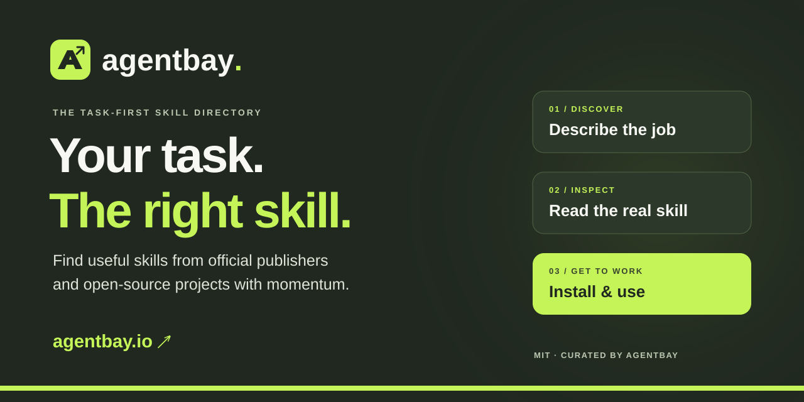

<!-- Generated by scripts/catalog.py; edit the maintained sources and regenerate. -->

# AgentBay Ultimate List

[](https://agentbay.io/)

**Start with a task. Find the skill. Get to work.**

[](LICENSE) [](https://agentbay.io/) [](docs/guardrails.md)

[Find a skill at AgentBay.io](https://agentbay.io/) · [Install AgentBay](#quick-start) · [Read the skill](skills/agentbay-skill-installer/SKILL.md) · [Browse the list](skills/README.md)

## Why I built AgentBay

I created AgentBay around one question: **What is the right skill for the task in front of me?**

You might be fixing a Cloudflare Worker, reviewing a pull request or turning a document into a spreadsheet. Somewhere, a team has already put useful knowledge into a skill. Finding it, understanding where it came from and getting your agent to use it should be straightforward.

That is what I want [AgentBay.io](https://agentbay.io/) and this repository to make easier: a practical reference that connects the work you need to do with instructions your agent can actually use. Browse on the site, explore the sources here, or bring AgentBay into your agent and ask in plain language.

## What could you use it for?

| Your task | Ask your agent | A useful next step |
| --- | --- | --- |
| Fix a Cloudflare Worker | Find a skill for debugging my Cloudflare Worker with AgentBay. | [Follow the local fix-and-test walkthrough](docs/cloudflare-first-use.md). |
| Review a landing page | Find a skill for reviewing my landing page’s accessibility with AgentBay. | [Try the HTML review example](docs/using-skills.md#first-worked-example). |
| Review a pull request | Find a skill for reviewing this pull request with AgentBay. | Match a review workflow to your project and inspect the diff. |
| Turn a PDF into a spreadsheet | Find a skill for extracting PDF tables into a spreadsheet with AgentBay. | Check extraction requirements and the spreadsheet output you need. |
| Diagnose a failing test | Find a skill for diagnosing this failing test with AgentBay. | Choose a workflow that fits your test runner, reproduce the failure and check the fix. |
| Create a slide deck | Find a skill for turning this brief into a slide deck with AgentBay. | Match a presentation workflow and check its export format. |

These prompts start discovery. After choosing a skill, ask AgentBay to install it, check prerequisites and use it. The linked walkthroughs show concrete examples and checks.

## Where I start: credible sources, visible momentum

My starting point is official sources from companies such as **Anthropic, OpenAI, Google, Microsoft, AWS and Cloudflare**, alongside GitHub projects with visible adoption and maintenance. Established teams often bring documented processes, review practices and continuity that are useful reasons to look at their work first.

Here is what matters when choosing a skill:

- **A source you can trace.** Our [preferred-provider registry](docs/providers.md) identifies verified publisher ownership and links back to official sources.
- **A repository worth investigating.** Stars and forks can point to community momentum; recent commits, releases and issue responses help you judge whether that attention comes with ongoing maintenance. Follow the repository link and look at the evidence.
- **A fit for the job.** AgentBay reads the publisher’s actual skill instructions and checks prerequisites before using a selected skill. The name alone is not enough.

These are useful signals, not a security certification. Official ownership does not establish that every skill was audited; popularity does not establish task fit. Independent maintainers can produce excellent work too.

**Explore 22,935 listings: 22,578 skills and 357 projects and tools across 9,156 GitHub repositories.**

## Quick start

AgentBay matches your task to skills using this repository’s curated catalogue, then reads the selected publisher’s actual instructions. Install AgentBay once; request other skills as you need them. You do not need to check out the whole repository.

**1. Install for your app.** For Codex desktop, CLI or IDE extension, run this in your project’s terminal:

```sh
npx --yes skills@1.7.4 add https://github.com/ravisingh11/agentbay-ultimate-list/tree/main/skills/agentbay-skill-installer --skill agentbay-skill-installer --agent codex --yes
```

> [!NOTE]
> Requires Node.js 22.20+, Git and internet access. While this repository is private, your GitHub account needs access. Use existing Git credentials or `gh auth login`; keep catalogue access available where your agent runs.

**Claude Code:** change `--agent codex` to `--agent claude-code`. **Claude desktop:** [download the skill ZIP](https://github.com/ravisingh11/agentbay-ultimate-list/raw/refs/heads/main/downloads/agentbay-skill-installer.zip) and upload it in Customize → Skills. [Steps for each app](docs/install.md) · [Optional installer script](install.sh).

**2. Open the skill.** [Read the maintained SKILL.md](skills/agentbay-skill-installer/SKILL.md). In Codex, open the same project, start a fresh chat and check its Skills view or `/skills` selector. The project copy is `.agents/skills/agentbay-skill-installer/SKILL.md`.

**3. Describe your task.**

> Find a skill for [my task] with AgentBay.

After choosing a result, ask: “Install this skill in my project, check its prerequisites, then use it for the task.” If AgentBay is not selected automatically, choose it in your app’s skill selector. Expect a source link, a readiness check and a verified task result. Installation does not grant cloud or account permissions.

[Try the Cloudflare Worker walkthrough](docs/cloudflare-first-use.md) · [Review an HTML example](docs/using-skills.md#first-worked-example) · [Updates, removal and version pinning](docs/using-skills.md) · [Verification and app test status](docs/installer-validation.md).

## Explore

- [Skills by category](skills/README.md)
- [Projects and tools by category](projects/README.md)
- [Preferred providers](docs/providers.md) · [How to install and use a skill](docs/using-skills.md)
- [Search the live AgentBay finder](https://agentbay.io/) · [Browse AgentBay’s full catalog](https://agentbay.io/catalog)

## Download

| List | JSON | CSV |
| --- | --- | --- |
| All listings | [catalog.json](catalog.json) | [catalog.csv](catalog.csv) |
| Skills | [JSON](skills/catalog.json) | [CSV](skills/catalog.csv) |
| Projects and tools | [JSON](projects/catalog.json) | [CSV](projects/catalog.csv) |

All six exports share one schema. Skills and projects are disjoint subsets of the combined list. A repository can contain several distinct skills. [Data fields and examples](docs/data.md).

## A living reference, maintained by AgentBay

This list is **sourced and maintained by [AgentBay](https://agentbay.io/)**. Imports bring in new listings and supported metadata; reviewed contributions add context and corrections that survive later imports. An entry disappearing from a website import does not automatically erase it here. [How curation works](docs/maintenance.md).

The website and repository serve different ways of exploring the same ecosystem. This repository publishes the broader catalogue, reusable downloads and installer skill. Website design, accounts and private collections stay on the site; relevant catalogue changes augment this list.

Listing summaries are generated from catalogue metadata; the linked publisher instructions remain the source to read before use. Stars and status checks are dated observations. [Data details](docs/data.md) · [Source and update evidence](sync-manifest.json).

## Contribute

Found a useful skill, a broken link or a better way to describe a task? Help make the next person’s search easier. [CONTRIBUTING.md](CONTRIBUTING.md) explains how to suggest a well-sourced change. [Contributors](CONTRIBUTORS.md) · [Report a security or privacy concern](SECURITY.md).

## 🛡️ How we look after the list

> [!NOTE]
> **We use [AI Software Toolkit](https://github.com/ravisingh11/ai-software-toolkit) to manage the checks and review workflow around catalogue data commits.** Its Proof checks validate proposed changes, while catalogue checks keep the generated README, browsing pages and JSON/CSV downloads consistent. Changes go through pull requests and maintainer review; the toolkit does not automatically approve, merge or publish them.

Public evidence, stable IDs, reproducible downloads and owner review keep contributions traceable. [See the guardrails](docs/guardrails.md) for the configured checks, shared engineering skills, recorded results and current enforcement limits.

## License

The catalogue, original documentation and maintenance tooling are available under the [MIT License](LICENSE). Listed software, skill instructions and publisher materials retain their own licenses. [License scope and third-party notices](LICENSING.md).
