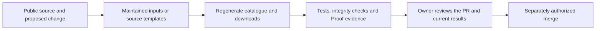

# 🛡️ How AgentBay looks after the list

[Home](../README.md) · [Contribute](../CONTRIBUTING.md) · [Current CI runs](https://github.com/ravisingh11/agentbay-ultimate-list/actions)

**A useful catalogue needs an inspectable maintenance process.** These guardrails protect the list, its installer and the contribution workflow. They do not certify the third-party skills we link to.

> [!IMPORTANT]
> Proof's selected policy controls remain **advisory**. GitHub separately enforces the [active repository rules](repository-hardening.md): PRs, required producer checks, resolved review threads and owner review for external contributions. A green check, installed skill or Proof allowance does not authorize merge, deployment or publication.

## Follow a change from suggestion to review



| Guardrail | What it protects | Where to inspect it |
| --- | --- | --- |
| Public supporting evidence | Listing identity, source paths, ownership and licensing claims | [Contribution guide](../CONTRIBUTING.md), [curation inputs](../data/curation.json) |
| Stable IDs and explicit removals | Existing links and reviewed contributions survive imports | [Maintenance policy](maintenance.md), [ID aliases](../provenance/aliases.json) |
| Reproducible catalogue exports | JSON, CSV, category pages and counts describe the same records | [Catalogue CI](../.github/workflows/validate.yml), [source/output hashes](../sync-manifest.json) |
| One maintained installer source | Repository ZIP and website release can be checked against the approved MD | [Source](../skills/agentbay-skill-installer/SKILL.md), [publication procedure](installer-maintenance.md#publish-an-approved-revision) |
| Independent installation/discovery check | The README package installs unchanged and is registered in Codex | [Credential-free CI job](../.github/workflows/validate.yml), [app verification limits](installer-validation.md) |
| Owner review | External contributions receive maintainer review, including policy and workflow changes | [CODEOWNERS](../.github/CODEOWNERS), [review policy](../CONTRIBUTING.md#maintainer-review) |
| Revision-bound Proof results | Findings belong to the tested commit; missing evidence stays visible | [Proof policy](../.proof/policy.yaml), [providers](../.proof/providers.yaml), Actions summaries/artifacts |
| Source and secret scans | Repository-owned static rules and available Git history are checked independently | [Semgrep workflow](../.github/workflows/semgrep-ce.yml), [Gitleaks workflow](../.github/workflows/gitleaks.yml) |

### A narrow, tested secret-scan exception

The generic API-key detector misread two public repository names, `fly0pants/admapix` and `normalled/apijack`, when each name was repeated at the start of its CSV description. These were metadata across a CSV boundary, not credentials. The four matches were the two names in the combined and skills CSV exports.

[`.gitleaks.toml`](../.gitleaks.toml) extends every default rule. Its exception applies only to `generic-api-key`, those two exact captured names and three explicit paths: the two CSV exports and the regression helper that names the fixtures. All conditions are required. No file, row, rule or historical commit is excluded wholesale.

The [policy regression check](../scripts/check_secret_scan_policy.py) uses the same pinned CI scanner to verify that the names are allowed, a generated credential-like sentinel in the **same CSV row** is still detected, another file receives normal detection, and a new sentinel in the helper source is still detected. CI runs it before the full history scan. The history scan covers roughly 103 MB and has a bounded 30-minute job budget; the scan scope and default rules are unchanged. Reproduce it with Git and Docker:

```sh
python3 scripts/check_secret_scan_policy.py
```

The test creates and removes its own temporary repository, reports only outcomes, and does not use real credentials.

## What is installed—and what that means

[AI Software Toolkit v2.3.2](https://github.com/ravisingh11/ai-software-toolkit/tree/v2.3.2) supplies the **starter** installation: Proof, CI templates and seven engineering skills for Codex and Claude Code. The release archive was checked against its published SHA-256 before installation. [Configuration](../toolkit.toml), [source revision and file hashes](../toolkit.lock.json), and the [retained MIT notice](licenses/ai-software-toolkit-MIT.txt) make the source inspectable.

Repository-owned policy, documentation mappings, source-check triggers, two manual-only workflows and the Gitleaks fixture step customize the pinned starter templates. Toolkit 2.3.2 was applied through its checksum-verified CLI update; custom migration, coverage, Gitleaks and provider files were preserved. The lock records the upstream baseline, so local workflow differences remain visible to future update previews. Review those differences instead of overwriting them.

The selected change controls are repository validation, documentation validation, declared ground truth, change scope, PR metadata, formatting/syntax, build, unit tests, static analysis and secret detection. They start advisory. The repository supplies its actual build, test and formatting commands through GitHub Actions variables; local users supply the same environment variables. No provider credentials are committed.

- **Installed:** the runtime, workflow or skill exists.
- **Configured:** its policy, input documents and command are supplied.
- **Verified:** the producer ran and its result identifies the evaluated revision.
- **Enforced:** GitHub blocks the protected operation. The [active rulesets](repository-hardening.md) require eleven producer checks and protect `main`; the advisory Proof scorecard is not itself a required merge check.

Database-migration validation is inactive because this repository has no database migration surface. Changed-code coverage is inactive until a real producer and reviewed threshold are adopted. The migration and coverage templates are manual-only until those controls are adopted. Advanced provider integrations, lifecycle tests and public scorecard hosting are not installed by this starter setup. No unavailable check is described as passing.

`change-scope` keeps the toolkit's advisory size budget; the initial toolkit installation is intentionally larger than a routine patch. Review that installation explicitly instead of raising limits to hide it. PR metadata requires the same sections as the [PR template](../.github/pull_request_template.md).

## Inspect or reproduce a result

For normal catalogue changes, Python 3.9+ and the standard library are sufficient:

```sh
python3 scripts/catalog.py render
python3 scripts/catalog.py check
python3 -m unittest discover -s tests -v
```

For Proof, use Python 3.11+ and a clean committed checkout. The repository's current producers are:

| Variable | Repository-owned command |
| --- | --- |
| `PROOF_BUILD_COMMAND` | `python3 scripts/catalog.py render && python3 scripts/catalog.py check && python3 scripts/installer.py check && python3 scripts/example_bundle.py check && python3 scripts/skill_bundle.py check && git diff --exit-code` |
| `PROOF_UNIT_TEST_COMMAND` | `python3 -m unittest discover -s tests -v` |
| `PROOF_FORMAT_LINT_COMMAND` | `git diff --check && bash -n install.sh && python3 -m compileall -q scripts tests` |

After exporting those variables in your shell, run the installed runtime without downloading another installer:

```sh
python3 .proof/doctor.py
python3 .proof/scan.py --base-ref origin/main
```

The scan writes ignored local evidence under `.artifacts/`; it does not publish a dashboard. Scanners need their executables locally, or can be inspected in hosted CI. Missing tools, a dirty tree, stale evidence and skipped checks must stay visible. For the toolkit command, use the checksum-verified archive or pinned source described in its [installation guide](https://github.com/ravisingh11/ai-software-toolkit/blob/v2.3.2/docs/install.md).

On a PR, open **Checks**, inspect the jobs and look for the evaluated head commit in Proof's Actions summary/artifacts. PR metadata and scorecard workflows execute the trusted base runtime. During the first installation PR, those base-branch workflows are not active yet; their hosted execution must be verified after the installation is merged. Do not substitute local evidence for that hosted result.

### Two events, two tested revisions

AgentBay owns these additional triggers; Toolkit 2.3.2 does not enable consumer main-branch checks automatically. Its [checkpoint guide](https://github.com/ravisingh11/ai-software-toolkit/blob/v2.3.2/docs/sdlc-checkpoints.md) explains the decision boundaries.

| Event | What runs | Revision and comparison |
| --- | --- | --- |
| PR opened, updated or reopened | Build, unit tests, syntax/lint, repository/documentation validation, Semgrep, full-history Gitleaks, catalogue/bundle checks and credential-free installer discovery | Explicit PR head checkout; diff-based documentation checks use the PR base. GitHub's synthetic event revision is recorded separately. |
| Push to `main` | The same source checks, including the existing catalogue and installer jobs | Actual resulting main commit; documentation comparison uses the push payload's `before` commit, covering the complete push rather than only its last commit. |
| PR metadata edit or review change | Existing metadata/scope/Proof workflows, using their trusted base runtime | Their PR snapshot/head identities remain separate from main-push results. |

Each source job records event/action, ref, tested commit, comparison base, workflow/job and run/attempt in its Actions summary through [`scripts/ci_context.py`](../scripts/ci_context.py). A checkout mismatch, malformed SHA or missing/zero ordinary main-push baseline fails the context step. A first push can use an initial-tree comparison only when GitHub marks it as branch creation and the actual checkout has no parents. That run validates every tracked file for documentation mappings, records that no prior commit exists, and does not invent a comparison commit. Manual verification of a root commit also uses its complete tree while retaining the manual checkpoint label. This record describes invocation; it is not signed provenance or a passing check. A cancelled or failing run remains cancelled or failed. Manual dispatch remains available and is labelled separately.

**Proof Scorecard remains PR-specific.** The installed collector requires PR-associated provider evidence; main-push source jobs are reviewed directly in Actions and are not relabelled as PR results or a main scorecard. PR metadata and change-scope controls do not become main-push controls. Migration, changed-code coverage, lifecycle and additional provider adoption remain unchanged.

For a workflow/runtime update, source producers may succeed while the trusted-base scorecard reports affected evidence as unavailable because its trusted paths changed. Report that state honestly; do not weaken its authority contract to turn it green. After an authorized merge, the new base can validate subsequent PRs under the adopted workflows.

Verify adoption on the real PR by inspecting the recorder and producer results at its exact head. After the separately authorized merge, inspect each `push` run at the resulting main SHA and its `before` baseline. No hosted main-push verification can be claimed before that merge. An earlier PR pass does not certify the merged commit, even when their trees match. A failing main run needs review and an explicitly authorized correction or revert; no deployment or automatic rollback is attached to these triggers.

### Check a contribution in GitHub

Open the pull request’s **Checks** tab and confirm that **PR Metadata**, **PR Change Scope** and **Proof Scorecard** ran. Inspect each producer’s result and the scorecard’s source revision; a workflow completing successfully does not make every advisory result a pass.

- PR metadata evaluates the current title and required body sections. Missing sections should remain visible as a failed advisory result until corrected.
- Change scope reports both total and meaningful changes. Its maintained policy excludes Markdown and other declared generated/vendor paths; those exclusions should remain visible in the report.
- The scorecard uses the trusted base runtime, collects evidence for the candidate revision, and keeps unavailable or failed results distinct from passing results. Retain the run links and inspect its uploaded evidence when investigating a mismatch.

These checks support owner review. Verify GitHub’s active branch settings separately before describing any check as merge enforcement.

## Boundaries that remain deliberate

The ordinary catalogue workflow has read-only repository permissions and does not execute linked publisher skills. The isolated installation check supplies no GitHub/model credentials. Model-backed tasks and real app sessions have separate [first-use checks](installer-validation.md); CLI discovery is not evidence that a desktop app completed a task.

Privileged PR metadata and scorecard jobs use the trusted base-branch runtime. Do not change them to execute contributor-controlled code with write credentials or secrets. Authenticated/model-backed checks require maintainer oversight; a contributor PR does not grant permission to send private source or project data to another service.

The repository is public. The [hardening record](repository-hardening.md) documents active settings read back from GitHub on October 28, 2026, including the precise check names, code-owner review, stale-approval dismissal and the owner's PR-only review bypass. Recheck those APIs and the current PR before relying on enforcement; `CODEOWNERS` alone is not enforcement. Changing visibility or relaxing protections requires explicit owner authorization.

## Repository image

The README uses the [AgentBay SVG](../assets/agentbay-repository.svg). Its [1280 × 640 PNG](../assets/agentbay-repository.png) is the upload-ready GitHub social preview; it is under 1 MB. Edit the SVG as the source and export the PNG at the same dimensions when changing the artwork. The artwork contains no changing catalogue counts or verification claims.

The image is ready for the public repository. Use **Settings → General → Social preview → Edit → Upload an image**. See [GitHub's social-preview instructions](https://docs.github.com/en/repositories/managing-your-repositorys-settings-and-features/customizing-your-repository/customizing-your-repositorys-social-media-preview).
